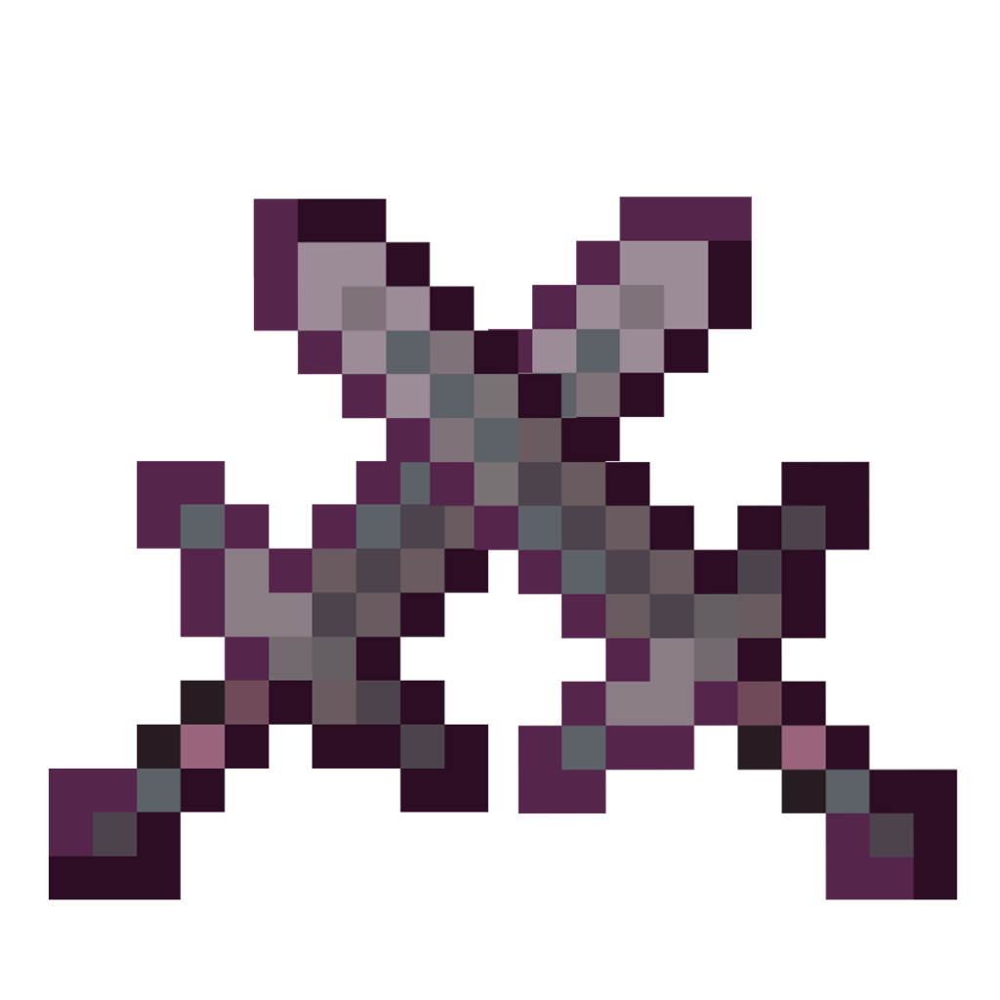

# CombatLog

A simple (not so much anymore) mod that tries to prevent players from leaving while in combat.

When one player hits another, both of them are tagged as in combat for a set time, 30 seconds by default, and the tag is refreshed with each hit. If a tagged player disconnects, they are killed and their items drop where they logged out. The kill can be turned off and replaced with a command.

## Features

- Tags both players on a hit, for a configurable time
- Countdown in the hotbar or on a boss bar
- Kills players who disconnect while tagged, with a configurable death message
- Can run a command on disconnect instead, or as well as
- Optional tagging from mobs, any damage, self damage and fire damage
- Blocks elytra takeoff, ender pearls, chosen items and blocks, and chosen commands while tagged
- Two command hooks, one when a player is tagged and one when a tagged player disconnects
- All messages and defaults in config/combatlog.toml, editable in game with /combatlog config

## Downloads

The latest release is on [Modrinth](https://modrinth.com/mod/combatlog) and [CurseForge](https://www.curseforge.com/minecraft/mc-mods/combatlog). The [releases page](https://github.com/WildToastyMop/CombatLog/releases) has a file for every loader and Minecraft version.

## Installation

Install it on the server. Clients do not need it, though it works in singleplayer and LAN worlds when installed there. The [installation page](https://github.com/WildToastyMop/CombatLog/wiki/Installation) covers supported versions, Java and which file to pick.

## Configuration

Settings live in `config/combatlog.toml`, created on first start. Edit the file and run `/combatlog reload`, or change values in game with `/combatlog config`; both write the same file.

Every option and default is on the [configuration page](https://github.com/WildToastyMop/CombatLog/wiki/Configuration), and the [commands page](https://github.com/WildToastyMop/CombatLog/wiki/Commands) lists the command syntax.

## Building

Needs Java 25 and the Gradle wrapper. `./gradlew buildAndCollect` builds every version and puts the jars in `build/libs/<mod version>/`; the [building page](https://github.com/WildToastyMop/CombatLog/wiki/Building) covers the IDE setup, building a single version and running a dev server.

## License

MIT. Modpacks are welcome to include it.
